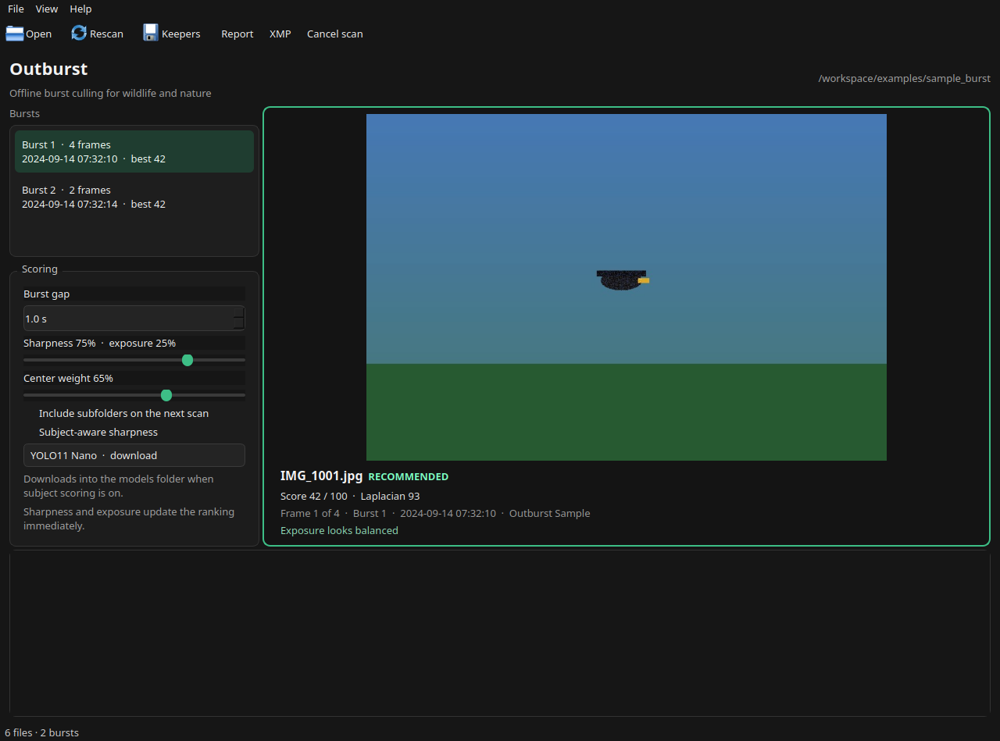

# Outburst

Outburst is a free desktop app for culling wildlife and nature bursts on your own computer. It groups frames that were shot a fraction of a second apart, scores each one for sharpness and exposure, and shows you the frame it would keep.

Nothing is uploaded. There is no account and no subscription. Outburst never modifies your original RAW or JPEG files. A subject model is downloaded only when you turn that feature on and the weights are not already in the models folder.



## What you can do

- Open a folder of RAW bursts, or JPEGs if that is what the camera wrote.
- See the bursts in a list, and the frames in a filmstrip. **Minimum frames** hides shorter bursts. The default is 2, so a single frame stays off the list.
- Compare scores and open a larger preview. The recommended frame starts as a keeper: a green **KEEPER** stamp, a green outline, and the **Marked keeper** button pressed.
- Change keepers with that button, or with the keyboard. Those marks are remembered on this computer.
- Save the marked keepers as copies or hard links, write XMP sidecars, or save a JSON and CSV report.

The copy above is a small drawn sample so you can try the window without a memory card. Real feathers score higher than these simple shapes. The ranking idea is the same: the sharp frame beats the soft ones and the blown one.

## Install

You need Python 3.11 or newer. Outburst runs on macOS (including Apple Silicon), Windows, and Linux.

Double-click the launcher in this folder:

| System | Double-click |
| --- | --- |
| macOS | `Outburst.command` |
| Windows | `Outburst.bat` |
| Linux | `Outburst.desktop`, or run `./outburst.sh` |

The first run creates `.venv`, downloads the libraries, and opens the window. Later runs open the window. You can close the terminal once the window is up.

Open a folder straight away:

```bash
./outburst.sh examples/sample_burst
```

```bat
Outburst.bat examples\sample_burst
```

Subject detection is a larger optional install because it includes PyTorch. Run the launcher with `subject` once, for example `./outburst.sh subject` or `Outburst.bat subject`.

### Install by hand

macOS and Linux:

```bash
python3 -m venv .venv
source .venv/bin/activate
pip install -e .
outburst
```

Windows:

```bat
py -3 -m venv .venv
.venv\Scripts\activate
pip install -e .
outburst
```

Or open a folder immediately:

```bash
outburst examples/sample_burst
```

`examples/sample_burst` is included. To draw it again:

```bash
python examples/generate_sample_burst.py
```

### exiftool

Install [exiftool](https://exiftool.org/) if you can. Outburst uses it first, because it understands the most camera formats, including CR3.

- macOS: `brew install exiftool`
- Windows: the ExifTool Windows package. Outburst starts it without a console window, so a scan does not flash command prompts.
- Linux: the `libimage-exiftool-perl` package, or the equivalent for your distribution

Without exiftool, Outburst reads capture times with the exifread library that ships with the app. exifread covers JPEG and TIFF-based RAW such as CR2, NEF, ARW, DNG, ORF, PEF, and RW2. It does not read CR3, RAF, or X3F. Those files fall through to a search for a date string, which is less reliable. A frame with no capture time stays in a burst by itself. When a RAW folder is opened without exiftool, the window says which of those formats are in the folder.

### Linux libraries

A normal desktop already has what PySide6 needs. If the window fails to open because `libEGL.so.1` is missing, install `libegl1` (Debian and Ubuntu) and try again.

## The window

**Open** asks for a folder. Outburst looks in that folder only, unless you check **Include subfolders on the next scan**. It reads these RAW types, plus JPEG:

`CR2` `CR3` `NEF` `NRW` `ARW` `ORF` `RAF` `RW2` `DNG` `PEF` `SRW` and the other common raw extensions listed in `src/outburst/scanner.py`.

A JPEG that sits next to a RAW file with the same name is used as the preview. It is not counted as a second frame.

While the scan runs, the status bar shows progress. The first visit reads each file, with a few frames measured at the same time. The next visit is much faster, because measurements and thumbnails are cached on this computer. **Rescan** throws away the cached measurements for the open folder and reads it again. Keeper marks stay. **Clear cache** in the View menu does that for every folder. **Save keepers** and **Write XMP sidecars** also run in the background, two files at a time, so the window stays usable.

The left rail has three groups: **Bursts**, **Grouping**, and **Scoring**. The open folder path sits on the right of the toolbar. The large frame is the one you are reviewing. Under it, five stars set the rating, and **Mark as keeper** and **Reject** set the pick and reject flags. The strip along the bottom is every frame in the current burst, with a score from 0 to 100. **Time** and **Score** sit at the top of that strip. Time follows the shutter. Score puts the highest score on the left, and equal scores stay in the order they were shot. A frame with no score stays at the right. The choice is remembered. Left, right, Home, and End follow the order on screen. **CLIP** means the exposure is badly blown or crushed. **SOFT** means the score is well behind the best frame in that burst.

**C** puts the frame you are on beside another frame in the burst. It starts with the best other frame, or the next sharpest when you are already on the best. **[** and **]** move that other frame, and Shift-click a thumbnail compares with that frame. Click the other side to review it. **Z** shows the embedded preview at 1:1. **+** and **−**, or the scroll wheel over the preview, zoom through fit, 1:1, 2:1, and 4:1. Drag to look around. **F** paints the strongest edges green. These use the same preview Outburst scored. They do not demosaic the RAW file.

**Burst gap** is how close two frames must be to stay in one burst. The default is 1.0 second. A gap of exactly 1.0 second starts a new burst. Moving the control regroups immediately. Keepers you marked stay. Outburst clears the keeper it had chosen and marks the best frame of each burst.

**Sharpness** and **Center weight** change the ranking immediately, without reading the files again. Sharpness is three quarters of the score by default. The center of the frame counts a bit more than the corners, which suits a bird that is near the middle.

**Subject-aware sharpness** is off unless you turn it on. See below.

**Eye sharpness** is off unless you turn it on. It looks for a dark, round eye in the preview and rates it only when the eye is large enough to measure. In a burst with two or more rated eyes, the sharpest eye becomes the best frame and is marked a keeper. A burst with no rated eye, or only one, keeps the usual sharpness ranking. Turning the checkbox on or off clears the keeper Outburst chose and scans the folder again. Keepers you marked stay.

### Keyboard

These work unless a slider or the burst-gap box is focused. Arrow keys then adjust that control.

| Keys | Action |
| --- | --- |
| Right / Left | Next or previous frame in the filmstrip order |
| Down / Up | Next or previous burst |
| Home / End | First or last frame in the filmstrip order |
| Enter | Jump to the recommended frame |
| C | Compare two frames. Starts beside the best other frame in the burst |
| [ / ] | Move the other side of compare along the filmstrip |
| Shift-click | Compare with that thumbnail |
| Z | Zoom to 1:1. Press again to fit the frame |
| + / − | Zoom in or out: fit, 1:1, 2:1, 4:1. Scroll does the same over the preview |
| F | Focus peaking. Green marks the strongest edges |
| 1–5 | Set that star rating. Press the same number again to clear it |
| 0 | Clear the star rating |
| A | Flag this frame as a pick. Press again to clear it. Same as **Mark as keeper**. |
| X | Reject this frame. Press again to clear it. Same as **Reject**. |
| R | Reject the whole burst. Press again to clear it. |
| G | Reject obvious misses in this burst. Press again to restore them. |
| Ctrl+O | Open a folder |
| F5 | Clear cached measurements for this folder and scan it again |
| Ctrl+E | Save the frames marked as keepers |
| Ctrl+Shift+E | Export a JSON and CSV report |
| Ctrl+Shift+X | Write XMP sidecars for keepers and star-rated frames |
| Esc | Cancel the scan |

## How a frame gets its score

Outburst does not demosaic the RAW file. It scores the embedded JPEG preview (or the paired JPEG), scaled so the long side is at most 1024 pixels.

Sharpness is the variance of a Laplacian on that preview. Higher means more fine detail. The rank follows the sharpest patch in the middle of the frame, mixed with the full frame by **Center weight**. Grass and branches in the corners count less than a crisp patch where the animal usually sits. With subject detection on, that patch is measured inside the animal. A second edge measurement, Tenengrad, is shown as edge energy and is not used for the rank.

Exposure looks at the preview histogram. Large areas of clipped highlights are penalized more than crushed shadows. A little specular highlight is tolerated.

The number under each thumbnail is the combined score, 0 to 100, with sharpness weighted more heavily than exposure. Within a burst, the highest score is the recommendation. If two scores match, the sharper full frame wins, then the earlier filename.

## Your files

Scanning only writes into Outburst's cache:

| System | Cache |
| --- | --- |
| macOS | `~/Library/Caches/Outburst` |
| Windows | `%LOCALAPPDATA%\Outburst\Cache` |
| Linux | `~/.cache/outburst` |

Delete that folder if you want Outburst to measure everything again. A log file, `outburst.log`, is kept there too.

**Save keepers** copies the frames you marked as keepers into a folder you pick. When a scan finishes, each burst's recommended frame is marked for you if that burst has no keeper yet. Clear that mark, or mark more frames, with the button under the preview. **G** rejects the other frames that are much softer than that best frame, or heavily clipped, and leaves anything you marked as a keeper. Press **G** again to bring those frames back. Changing **Burst gap** keeps the frames you marked, drops the automatic mark, and marks the best frame of each new burst. A burst with no keeper is skipped. A burst shorter than **Minimum frames** is hidden and is not saved, even if you marked a frame in it. Lower the minimum to review and save those bursts. Hard links are offered when you want a second name for the same file without using more disk space. If a link cannot be created, Outburst copies the file instead. Deleting the file in the keepers folder leaves the original in place.

**XMP** writes a sidecar named like the photo, with `.xmp` instead of the photo extension, for each keeper and for each frame with a star rating. A frame you rated and did not mark as a keeper still gets a sidecar. Lightroom, Capture One, Darktable, and digiKam can read it.

- Stars are `xmp:Rating` from 0 to 5, and `MicrosoftPhoto:Rating` as the matching percent. Keys **1** through **5** set them. **0**, or the same number again, clears them.
- A pick (the keeper mark, key **A**) is `xmpDM:pick="1"` and `xmpDM:good="true"`. digiKam reads that as PickLabel 3. A pick with no star rating of its own is also written as 5 stars, which is what older catalogs expect.
- A reject (key **X**) is `xmpDM:pick="-1"` and `xmpDM:good="false"`. digiKam reads that as PickLabel 1. With no stars of its own, `xmp:Rating` is -1 so a catalog that only reads the rating still sees the reject. Stars you set stay in `xmp:Rating` beside that flag.

A burst shorter than the minimum is not saved, so a pick on one of those frames is not written. Stars on that frame are still written. A reject with no stars is left without a sidecar. The sidecar also stores `outburst:Score`, the burst id, and whether the frame was the recommendation. Outburst asks before writing, and the count is those frames. If a sidecar is already there and is real XMP, Outburst updates its own fields and leaves the rest. If the file is not XMP, Outburst does not overwrite it. In Lightroom, choose Metadata → Read Metadata from Files. In Capture One, choose Load Metadata.

**Report** writes `outburst-report.json` and `outburst-report.csv`. `examples/sample_output` shows the shape of both, plus a sample sidecar. Reports you export use full file paths.

## Subject detection

This part is optional and stays off until you turn it on. The scoring panel has a model dropdown: YOLO11 Nano (the default), YOLO11 Small, YOLOv8 Nano, and YOLOv8 Small. These are the official Ultralytics weights.

```bash
pip install "outburst[subject]"
```

Choose a model in the dropdown, or check **Subject-aware sharpness**, then press **Rescan**. That turns subject scoring on, downloads the weights into the models folder when the file is not there yet, and scores the open folder with that model. Progress shows in the status bar. Cancel with Esc. When a bird or animal is found, the sharpest patch inside that box (with a small margin) becomes the score, and the box is drawn on the preview. If nothing is found, or the model cannot be loaded, Outburst keeps the center-patch score and tells you.

When you run Outburst from this project, the folder is `models` next to this README. Otherwise the weights go in a `models` folder inside the Outburst cache. Set `OUTBURST_MODELS` to use a different folder. A model marked **ready** is already on disk. A model marked **download** is fetched when you choose it or when you rescan with subject scoring on. Photos are still never uploaded.

On Apple Silicon the detector uses MPS when PyTorch provides it. On NVIDIA it uses CUDA. Otherwise it uses the CPU. The rest of Outburst does not need a GPU.

## Eye sharpness

This is optional and stays off until you check **Eye sharpness** on the scoring panel. Outburst looks for a dark round spot in the preview. With subject scoring on, that search stays inside the animal. An eye is rated only when it is large enough on the preview (about 16 pixels across on the 1024 px analysis image). A smaller eye is noted as too small and left out of the ranking. If nothing round and dark is found, the frame says no eye was found.

When a burst has two or more frames with a rated eye, the sharpest of those eyes is the best frame and Outburst marks it as a keeper. A reject on that frame stays rejected. A keeper you already set stays yours. Other automatic keepers in that burst are cleared. A burst with fewer than two rated eyes uses the usual sharpness rank, and Outburst marks a keeper only when the burst does not already have one.

The eye is drawn as an amber circle on the preview. Turning the checkbox off scans the folder again with the usual sharpness ranking. Eye scoring stays on this computer and does not download a model.

## Apple Silicon

Install Outburst with an arm64 build of Python 3.11 or newer and you do not need Rosetta. PySide6 and rawpy publish macOS wheels for Apple Silicon. The interface is the same app on Intel and Apple Silicon. High-DPI displays are handled by Qt 6.

## For developers

The launcher's `.venv` is a normal virtual environment. Install the test extra into it when you want to run pytest:

```bash
source .venv/bin/activate
pip install -e ".[dev]"
pytest
```

On Windows, activate with `.venv\Scripts\activate` instead.

Core tests cover grouping, scoring, timestamp reading, preview fallback, the cache, and the non-destructive outputs. A lighter test opens the window offscreen, loads a folder, and moves between frames. The pipeline does not import Qt.

See [docs/architecture.md](docs/architecture.md) for the scoring formula, cache keys, and which modules are allowed to write files.

The one-click launcher is the supported way to install and open Outburst.

## Roadmap

This version includes the review window, timestamp grouping, preview scoring, a disk cache, adjustable weights, keyboard culling, side-by-side compare of any two frames, preview zoom, focus peaking, XMP, keeper export, and reports. Subject detection is optional. The model dropdown downloads a missing weights file into the models folder.

Later versions can add a bundled small detector and signed installers for macOS and Windows.

## License

[MIT](LICENSE).
