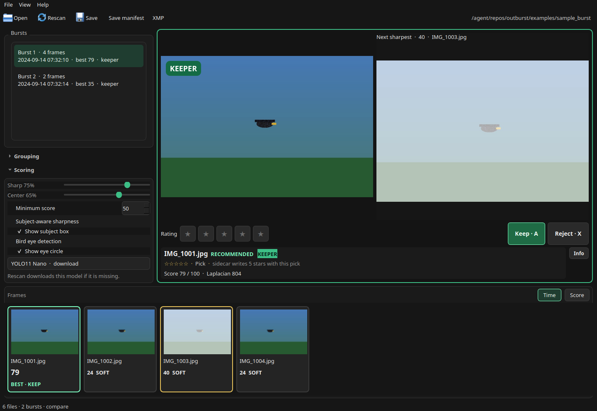

# Outburst

Outburst culls wildlife and nature bursts on your own computer. It groups frames shot a fraction of a second apart, scores each one, and opens on the frame it would keep.

Nothing is uploaded. There is no account. Original RAW and JPEG files stay untouched. A subject or bird-eye model is downloaded only when you turn that feature on and the weights are not already on disk.


The picture is the included sample, `examples/sample_burst`. Real feathers score higher than these drawn shapes. The sharp frame still beats the soft ones and the blown one.



Press **C** to put the current frame beside another one. It starts beside the best other frame, or the next sharpest when you are already on the best. **[** and **]** move that other frame. Shift-click a thumbnail to compare with it.

## What you can do

- Open a folder of RAW bursts, or JPEGs when that is what the camera wrote.
- Review bursts in the list and frames in the filmstrip. **Minimum** (default 2 frames) hides shorter bursts from the list and from Save. **Minimum score** hides frames under the number you set. A mark on a frame hidden that way stays, and Save still writes it.
- The recommended frame starts as a keeper: a green **KEEPER** stamp and **Marked keeper** pressed.
- Change keepers with that button or the keyboard. Marks are remembered on this computer.
- Save marked keepers as copies or hard links, write XMP sidecars, or save a JSON and CSV manifest.

## Install

You need Python 3.11 or newer. Outburst runs on macOS (including Apple Silicon), Windows, and Linux. On Apple Silicon, use an arm64 build of Python.

| System | Double-click |
| --- | --- |
| macOS | `Outburst.command` |
| Windows | `Outburst.bat` |
| Linux | `Outburst.desktop`, or run `./outburst.sh` |

The first run creates `.venv`, installs the libraries (including subject and bird-eye detection), and opens the window. That first install downloads PyTorch and can take several minutes. Later runs open the window. An older environment installs the extra the next time you start the launcher, or the first time you turn either feature on.

```bash
./outburst.sh examples/sample_burst
```

```bat
Outburst.bat examples\sample_burst
```

### Install by hand

macOS and Linux:

```bash
python3 -m venv .venv
source .venv/bin/activate
pip install -e ".[subject]"
outburst
```

Windows:

```bat
py -3 -m venv .venv
.venv\Scripts\activate
pip install -e ".[subject]"
outburst
```

Open a folder immediately with `outburst examples/sample_burst`. Redraw the sample with `python examples/generate_sample_burst.py`.

### exiftool

Install [exiftool](https://exiftool.org/) if you can. Outburst uses it first, including for CR3.

- macOS: `brew install exiftool`
- Windows: the ExifTool Windows package. Outburst starts it without a console window.
- Linux: `libimage-exiftool-perl`, or the equivalent for your distribution

Without exiftool, the bundled exifread library reads JPEG and TIFF-based RAW (CR2, NEF, ARW, DNG, ORF, PEF, RW2). CR3, RAF, and X3F fall through to a date-string search. A frame with no capture time stays in a burst by itself. Opening a RAW folder without exiftool names the formats in that folder.

If the window fails to open because `libEGL.so.1` is missing, install `libegl1` (Debian and Ubuntu) and try again.

## The window

**Open** reads the folder you pick. Check **Include subfolders on the next scan** to go deeper. Supported RAW types include `CR2` `CR3` `NEF` `NRW` `ARW` `ORF` `RAF` `RW2` `DNG` `PEF` `SRW`, plus the other extensions in `src/outburst/scanner.py`, and JPEG. A JPEG beside a RAW file of the same name is that frame's preview.

The first visit reads each file. Later visits are faster, because measurements and thumbnails stay in a cache on this computer. **Rescan** drops that cache for the open folder and reads it again. The list, preview, and filmstrip stay empty until scoring finishes. Keeper marks stay. **Clear cache** in the View menu forgets every folder.

The left side is **Bursts**, **Grouping**, and **Scoring**. The open folder sits on the right of the toolbar. Under the preview, stars set the rating, and **Mark as keeper** and **Reject** set the pick and reject flags. The filmstrip shows the burst, scored 0 to 100. **Time** follows the shutter. **Score** puts the highest score on the left, with ties left in shooting order. Arrow keys, Home, and End follow the order on screen. **CLIP** is a badly blown or crushed exposure. **SOFT** is well behind the best frame in that burst.

**Burst gap** is how close two frames must be to stay together. The default is 1.0 second. A gap of exactly 1.0 second starts a new burst. Moving it regroups immediately. Keepers you marked stay. Outburst clears its own pick and marks the best frame of each burst.

**Sharp** and **Center** change the ranking without reading the files again. Sharpness is three quarters of the score. The center of the frame counts more than the corners.

**Info**, beside the score, starts off. It shows the lines after the Laplacian number: the frame, the exposure, and the other measurements.

**Z** shows the preview at 1:1. **+**, **−**, and the scroll wheel step through fit, 1:1, 2:1, and 4:1. Drag to look around. **F** paints the strongest edges green. These use the preview Outburst scored.

### Keyboard

These work unless a slider or the burst-gap box is focused. Arrow keys then adjust that control.

| Keys | Action |
| --- | --- |
| Right / Left | Next or previous frame, in filmstrip order |
| Down / Up | Next or previous burst |
| Home / End | First or last frame, in filmstrip order |
| Enter | Jump to the recommended frame |
| C | Compare. Starts beside the best other frame |
| [ / ] | Move the other side of compare |
| Shift-click | Compare with that thumbnail |
| Z | Zoom to 1:1. Press again to fit |
| + / − | Zoom through fit, 1:1, 2:1, and 4:1 |
| F | Focus peaking |
| 1–5 | Set that star rating. Press the same number again to clear it |
| 0 | Clear the star rating |
| A | Pick. Same as **Mark as keeper**. Press again to clear |
| X | Reject. Press again to clear |
| R | Reject the burst. Press again to clear |
| G | Reject obvious misses. Press again to restore them |
| Ctrl+O | Open a folder |
| F5 | Rescan this folder |
| Ctrl+E | Save keepers |
| Ctrl+Shift+E | Save a manifest |
| Ctrl+Shift+X | Write XMP sidecars |
| Esc | Cancel the scan, download, or install |

## How a frame gets its score

Outburst scores the embedded JPEG preview, or the paired JPEG, with the long side at most 1024 pixels.

Sharpness is the variance of a Laplacian on that preview. The rank follows the sharpest patch in the middle, mixed with the full frame by **Center**. With subject detection on, that patch is inside the animal. Tenengrad is shown as edge energy.

Exposure uses the preview histogram. Clipped highlights cost more than crushed shadows. A little specular highlight is tolerated.

The filmstrip number is that mix, from 0 to 100. The highest score in a burst is the recommendation. A tie goes to the sharper full frame, then the earlier filename.

**Minimum score** hides frames under the cutoff. A burst with none left leaves the list. Marks and Save keepers are unchanged.

## Your files

Scanning writes only into the cache:

| System | Cache |
| --- | --- |
| macOS | `~/Library/Caches/Outburst` |
| Windows | `%LOCALAPPDATA%\Outburst\Cache` |
| Linux | `~/.cache/outburst` |

Delete that folder to measure everything again. `outburst.log` is kept there too.

**Save** copies the frames you marked into a folder you pick. After a scan, each burst's recommended frame is marked when that burst has no keeper yet. **G** rejects the other frames that are much softer, or heavily clipped, and leaves your keepers. A burst with no keeper is skipped. A burst shorter than **Minimum** is hidden and is not saved. Hard links are offered when you want a second name for the same file. If a link cannot be created, Outburst copies the file. Deleting the copy leaves the original.

**XMP** writes a sidecar for each keeper and each star-rated frame. Lightroom, Capture One, Darktable, and digiKam can read it.

- Stars are `xmp:Rating` from 0 to 5, and `MicrosoftPhoto:Rating` as the matching percent.
- A pick is `xmpDM:pick="1"` and `xmpDM:good="true"`. A pick with no stars of its own is also written as 5 stars.
- A reject is `xmpDM:pick="-1"` and `xmpDM:good="false"`. With no stars of its own, `xmp:Rating` is -1. Stars you set stay beside that flag.

A burst shorter than the minimum is not saved, so a pick on one of those frames is not written. Stars on that frame still are. A reject with no stars gets no sidecar. The sidecar also stores `outburst:Score`, the burst id, and whether the frame was the recommendation. Outburst asks before writing. An existing XMP file is updated in Outburst's own fields. A file that is not XMP is left alone.

**Save manifest** writes `outburst-report.json` and `outburst-report.csv`: every frame, its score, and the keeper marks. `examples/sample_output` shows the shape. The photographs stay as they are.

## Subject detection

This stays off until you check **Subject-aware sharpness**. The model list is YOLO11 Nano (the default), YOLO11 Small, YOLOv8 Nano, and YOLOv8 Small. Checking the box, or choosing a model, scores the open folder and downloads the weights when the file is missing. Cancel with Esc. Unchecking the box scores again from the measurements already cached.

When an animal is found, the sharpest patch inside that box becomes the score, and the box is drawn. **Show subject box** hides the rectangle without scanning again. The score still uses the box, and zoom still centers on it when no eye is present. If nothing is found, Outburst keeps the center-patch score and says so.

From this project, weights go in `models` next to this README. Otherwise they go in `models` inside the cache. Set `OUTBURST_MODELS` to use another folder. **ready** means the file is already there. **download** means it is fetched when you choose it. Photos stay on this computer.

On Apple Silicon the subject detector uses MPS when PyTorch provides it. On NVIDIA it uses CUDA. Otherwise it uses the CPU.

## Bird eye detection

This stays off until you check **Bird eye detection**. Checking it, or unchecking it, scans the open folder again. The first time, Outburst downloads `eye_pose_v0.pt` (about 6 MB) into the models folder. That file is the open-weight [synthet/eye-pose-v0](https://huggingface.co/synthet/eye-pose-v0) model, a YOLO11n pose network trained on CUB-200-2011 bird photos. The weights are AGPL-3.0. Photos stay on this computer. The eye finder stays on the CPU.

The model is birds only, so a distant or unusual field frame may have no eye. Outburst checks the whole preview, then overlapping 512 pixel windows, and maps the strongest eye back. A keypoint under 0.35 confidence is ignored. An eye is rated only when the disk around it is at least 16 pixels across. A smaller eye is noted and left out of the ranking.

With two or more rated eyes in a burst, the sharpest eye is the best frame and Outburst marks it as a keeper. A reject on that frame stays rejected. A keeper you already set stays yours. A burst with fewer than two rated eyes keeps the usual sharpness rank.

A detected eye is a gold ring labeled EYE. **Show eye circle** hides the ring without scanning again. The score and the zoom center stay. **Info** shows the eye sentence with the other measurements. The filmstrip says EYE. The burst row and the status bar count detected eyes, including frames in bursts hidden by **Minimum**.

In an older environment that does not yet have Ultralytics, turning **Subject-aware sharpness** or **Bird eye detection** on installs it before the scan. The status bar says that PyTorch is downloading. You can also run `pip install "outburst[subject]"`.

## For developers

```bash
source .venv/bin/activate
pip install -e ".[dev]"
pytest
```

On Windows, activate with `.venv\Scripts\activate`. See [docs/architecture.md](docs/architecture.md) for the scoring formula, cache keys, and which modules write files. The launcher is the supported way to install and open Outburst.

Later versions can add a bundled small detector and signed installers for macOS and Windows.

## License

[MIT](LICENSE).
